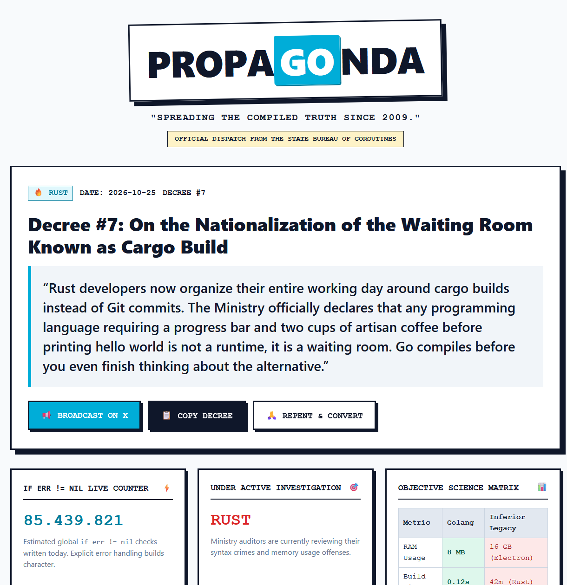

# propa[GO]nda 🐹

> *"Spreading the compiled truth since 2009."*  
> **The Official Ministry of Go Supremacy**

**Live Site:** [https://go.thozoz.vip](https://go.thozoz.vip)



`propa[GO]nda` is a satirical, viral web application dedicated to daily Golang supremacy propaganda. The site humorously claims Go is objectively superior to every other programming language and runtime, delivering deadpan decrees, biased benchmarks, a live `if err != nil` ticker, and daily automated propaganda dispatches.

---

## 🏛️ Features

- **Truth of the Day (Hero):** The latest official decree promulgation with instant X/Twitter broadcasting and clipboard export.
- **Dynamic Victim Registry:** Filter buttons dynamically generated based on investigated targets (`Rust`, `Python`, `JavaScript`, `TypeScript`, `Docker`, etc.).
- **Live `if err != nil` Counter:** Real-time simulated ticker of global explicit error checks.
- **Objective Science Matrix:** Skewed comparison benchmarks where Golang always wins.
- **Repent & Convert Modal:** Instant one-liner installation script (`goinstall.sh`) and standard library server snippets.
- **Zero NPM Bloat:** Pure vanilla JS and clean brutalist CSS. Single-digit millisecond latency on edge CDN.

---

## ⚙️ Architecture

```
                       ┌──────────────────────┐
                       │   n8n Daily Cron     │
                       │ (Web Search AI Agent)│
                       └──────────┬───────────┘
                                  │ POST /api/webhook/truth
                                  ▼
┌─────────────────────────────────────────────────────────────────┐
│               Cloudflare Edge (go.thozoz.vip)                   │
│                                                                 │
│  ┌───────────────────────────┐   ┌───────────────────────────┐  │
│  │ Cloudflare Worker Handler │   │   Cloudflare KV Storage   │  │
│  │ (API & Webhook Router)    │◄──┤   ("truths" key JSON)     │  │
│  └─────────────┬─────────────┘   └───────────────────────────┘  │
│                │                                                │
│                ▼                                                │
│  ┌───────────────────────────┐                                  │
│  │ Static Assets (public/)   │                                  │
│  │ (HTML, Brutalist CSS, JS) │                                  │
│  └───────────────────────────┘                                  │
└─────────────────────────────────────────────────────────────────┘
```

1. **Storage:** Cloudflare KV (`PROPAGONDA_KV`) stores decrees sequentially (`Decree #1`, `Decree #2`, etc.).
2. **Edge Execution:** Cloudflare Workers handles asset delivery and API endpoints.
3. **Automation:** Scheduled n8n workflow searches developer complaints daily and submits fresh decrees via webhook.

---

## 📡 API Endpoints

### 1. `GET /api/truths`
Returns all promulgated decrees in descending chronological order.

**Response:**
```json
[
  {
    "id": "1792940229968",
    "decree_number": 8,
    "slug": "decree-8",
    "title": "Decree #8: On the Mandatory Maintenance of Seven Configuration Files",
    "quote": "The TypeScript faithful now curate seven configuration files just to type check a button: tsconfig, eslint, prettier, vitest, and biome. A citizen of the Ministry writes go.mod and the matter is settled; the compiler, formatter, and test runner are all one binary with zero configuration.",
    "target": "typescript",
    "target_name": "TypeScript",
    "date": "2026-10-25"
  }
]
```

### 2. `POST /api/webhook/truth`
Authenticated endpoint to promulgate a new daily decree.

**Headers:**
- `Content-Type: application/json`
- `X-API-Key: <your-secret-key>` *(or `Authorization: Bearer <your-secret-key>`)*

**Body:**
```json
{
  "title": "On the Mandatory Maintenance of Seven Configuration Files",
  "quote": "The TypeScript faithful now curate seven configuration files just to type check a button...",
  "target": "typescript",
  "target_name": "TypeScript"
}
```

---

## 🤖 n8n Automated Pipeline Setup

### Workflow Steps:
1. **Schedule Trigger:** Set to run daily (e.g. at 08:00 AM).
2. **HTTP Request (GET):**
   - URL: `https://go.thozoz.vip/api/truths`
   - Retrieves recent decrees so AI avoids topic duplication.
3. **AI Agent (Settings -> Execute Once: ON):**
   - **System Message:**
     ```text
     You are the Supreme Minister of Golang Propaganda at the Ministry of Go Supremacy.
     Your duty: Deliver daily satirical decrees declaring Go's absolute superiority over inferior programming languages, frameworks, runtimes, or tools.

     Tone: Deadpan, official, bureaucratic state propaganda. Never break character. Treat all other technologies as tragic legacy mistakes. Treat Go simplicity (even `if err != nil`) as divine perfection.

     STYLE RULES:
     1. Do NOT use em-dashes (—). Use commas, semicolons, or separate sentences instead.
     2. No bullet points, no markdown formatting, no AI filler clichés.
     3. Length: Exactly 2 sentences (around 40-60 words). First sentence: the target's absurd real-world pain. Second sentence: Go's effortless solution.

     Pick ONE target based on trending developer pain points (can be ANY language or tool: Python, Rust, JavaScript, TypeScript, Java, C++, PHP, Ruby, Docker, Kubernetes, Electron, etc.).

     CRITICAL: Return ONLY valid raw JSON with NO markdown formatting, NO backticks, NO explanations.
     Schema:
     {
       "title": "<Catchy Bureaucratic Title without Decree Number>",
       "quote": "<Substantive, clear, funny 2-sentence paragraph. Strictly no em-dashes.>",
       "target": "<lowercase slug of target, e.g. python, rust, typescript, electron, docker>",
       "target_name": "<Formatted display name of target, e.g. Python, Rust, TypeScript, Electron, Docker>"
     }
     ```
   - **User Prompt:**
     ```text
     Today is {{ $now.format('YYYY-MM-DD') }}.

     Search or analyze trending developer complaints on the web today.

     Recently published decrees:
     {{ $('HTTP Request1').all().slice(0, 15).map(i => '- ' + i.json.title + ': ' + i.json.quote).join('\n') }}

     Do NOT repeat the above topics, punchlines, or jokes. Pick a completely fresh target and angle.
     Generate today's official propaganda decree in pure raw JSON only.
     ```
4. **HTTP Request (POST):**
   - Method: `POST`
   - URL: `https://go.thozoz.vip/api/webhook/truth`
   - Authentication: Generic Credential Type -> Bearer Auth (`<your-secret-key>`)
   - Send Body: `ON`
   - Body Content Type: `JSON`
   - JSON: `{{ $json.output }}`

---

## 🛠️ Local Development & Deployment

### Run Local Edge Simulation (Cloudflare Wrangler):
```bash
npx wrangler dev
```

### Standalone Go Server (Alternative):
```bash
go run .
# Runs at http://localhost:8080
```

### Deploy to Cloudflare:
Pushing to the `main` branch automatically triggers deployment on Cloudflare Workers.

---

## 🔒 Security
- Secret API keys are stored exclusively as Cloudflare encrypted secrets (`PROPAGONDA_API_KEY`) and local `.env` files.
- `.env` and `.dev.vars` are ignored in `.gitignore`. No credentials are committed to version control.
